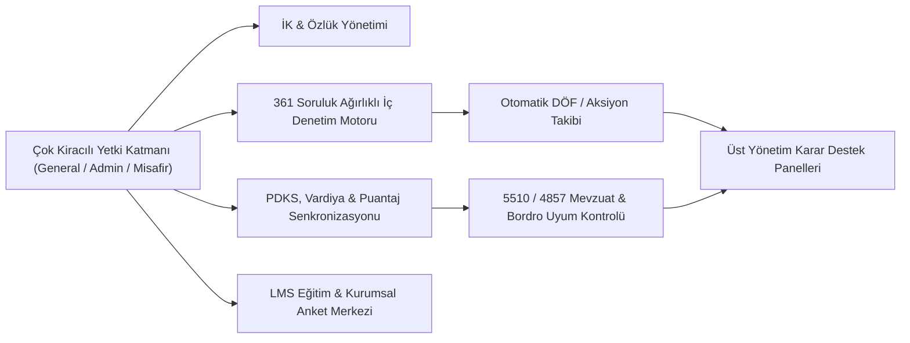

# GYS • Kurumsal Genel Yönetim ve İç Denetim Mimarisi

> **Not:** Bu depo kurumsal güvenlik ve veri gizliliği ilkeleri gereği kaynak kod içermez; `gys.generalist.tr` ve `generalist.tr/personel` sistemlerinin **mimari tasarımını, süreç akışını ve yetki modelini** belgelemek amacıyla yayımlanmıştır.

## 1. Çözülen Kurumsal İhtiyaç
Çok şubeli ve çok şirketli kurumsal yapılarda insan kaynakları operasyonlarını, saha/mağaza iç denetimlerini, mevzuat uyumunu (4857 sayılı İş Kanunu ve 5510 sayılı SSGSSK) ve düzeltici/önleyici faaliyetleri (DÖF) tek bir denetlenebilir merkezde toplamak.

## 2. Sistem Mimarisi

## 3. Temel Mimari Bileşenler
- **Çok Kiracılı (Multi-Tenant) İzolasyon:** Şirket ve şube bazında ayrıştırılmış veri katmanı ve kademeli rol matrisi.
- **361 Soruluk İç Denetim & DÖF Motoru:** Saha ve mağaza denetimlerinde kategori ağırlıklı puanlama, uygunsuzluk tespiti ve termin süreli otomatik DÖF (CAPA) üretimi.
- **Personel & PDKS Otomasyonu (`generalist.tr/personel`):** Aylık puantaj, vardiya, yıllık izin, fazla mesai ve işe alım mülakat değerlendirme süreçlerinin uçtan uca entegrasyonu.
- **Çevrimdışı / Masaüstü Çalışma Desteği:** Yerel çalışma zamanı (hibrit masaüstü paketleme) ve canlı bulut senkronizasyonu.

## 4. Bağlantılar
- **GYS Portalı:** [https://gys.generalist.tr/](https://gys.generalist.tr/)
- **Personel & PDKS Modülü:** [https://generalist.tr/personel/](https://generalist.tr/personel/)
- **Sistem Mimarı:** [Abdülkadir Aygün — generalist.tr](https://generalist.tr)
